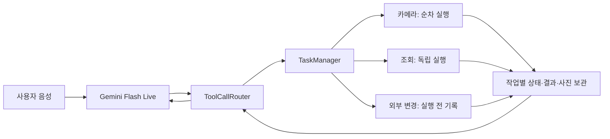

# 실시간 대화의 병렬 작업·결과 보관 적용 내역

작성일: 2026-09-19

## 변경 목적

Gemini Flash가 사용자 발화의 의미와 도구 선택을 계속 담당하고, Android 앱이 작업 실행과 결과의 수명을 관리하도록 변경했다. 사진을 찍는 중에 DB 검색을 요청해도 독립 작업은 병행할 수 있다. 화제가 바뀐 작업의 결과는 현재 답변에 끼워 넣지 않고 보관하며, 나중에 사용자가 요청하면 조회한다.

이 문서는 이번에 실제 구현한 범위를 설명한다. 이전 `task-orchestration.md`는 더 넓은 제안 설계이며, 구현과의 차이는 아래 제한 사항에 명시한다.

## 사용자에게 달라지는 동작

| 상황 | 적용한 동작 |
|---|---|
| 촬영 중 사람/기억 검색 추가 | 촬영과 조회를 독립 실행. 이전 결과는 작업별로 보관 |
| 같은 카메라로 촬영 두 번 요청 | 순차 실행. AI 촬영과 화면 촬영 버튼도 같은 카메라 잠금을 사용 |
| 다른 주제 이야기 | 대화 관심 작업을 해제. 독립 조회/촬영은 유지하고 완료 결과 보관 |
| "사진 말고 사람 찾아" | Flash가 `update_task(cancel)` 후 새 도구를 호출하도록 안내. 취소된 버전의 늦은 결과 반영 금지 |
| "잠깐 보류", "아까 계속" | 보류/재개 도구 제공. 재개는 새 버전으로 실행. 이미 외부에 전송된 쓰기는 재실행 금지 |
| "아까 사진/검색 결과 알려줘" | `list_tasks`로 찾고 `get_task_result`로 보관 결과 조회 |
| 사진을 확인한 다음 저장 | 확인한 사진 작업 ID·버전을 참조. 저장 시 재촬영하지 않음 |
| 촬영 취소 직후 사진 도착 | 현재 대화로 자동 전송하지 않으며 취소된 작업 결과로 채택하지 않음 |
| 저장/전송 중 취소·실패 | 이미 전송됐다면 `outcome_unknown`으로 표시할 수 있음. 성공/취소를 임의로 단정하지 않고 자동 재시도 금지 |
| 앱 프로세스 재시작 | 보관한 결과 복원. 진행 중이던 읽기는 보류, 전송된 외부 변경은 결과 미확정으로 복원. 자동 재실행하지 않음 |

## 구현 구조



### 판단과 실행 분리

- Flash가 계속/정정/대체/취소/추가/후속/상태 문의를 문맥으로 판단한다. 별도 분류 모델은 추가하지 않았다.
- 앱은 존재하지 않는 작업 ID, 오래된 버전, 완료되지 않은 선행 작업, 변경된 입력으로 기존 작업 재사용을 거부한다.
- 사용자 끼어들기와 Live API의 `toolCallCancellation`을 업무 전체 취소로 취급하지 않는다. 백그라운드 읽기·촬영은 유지할 수 있다.
- 외부 변경이 아직 실행되지 않았는데 새 발화가 들어오면 해당 작업은 보류한다. 실제로 전송된 변경을 클라이언트 취소로 되돌렸다고 표시하지 않는다.

### 작업 식별과 정책

`TaskRecord`는 앱 발급 `id`, `revision`, 도구명, 입력, 제목, 상태, 생성/변경 시각, 결과, 오류, 외부 변경 전송 표시, 선행 작업 ID/버전, Gemini 해석을 보관한다.

이번 구현에서 작업 레코드는 **개별 도구 작업 단위**다. 여러 단계의 사용자 목적 전체를 하나의 DAG로 자동 실행하는 엔진은 아니다. 후속 작업은 Flash가 완료 결과와 `source_task_id/source_revision`을 이용해 연결한다.

상태:

- `queued`, `running`: 대기/실행 중
- `waiting_user`: 전화·문자 확인 대기
- `held`: 보류
- `completed`, `failed`, `cancelled`: 완료/실패/논리적 취소
- `outcome_unknown`: 외부 실행 여부를 확정할 수 없음

정책은 `TaskPolicies`에 등록한다. 조회·촬영의 백그라운드 실행 여부, 자원 키, 외부 변경 여부, 제한 시간을 지정한다. 카메라, DB 쓰기, 기기 실행 등 같은 자원의 작업은 직렬화하고 독립 자원은 병행한다. 새 도구는 정책과 실행 어댑터를 등록해야 한다.

### Gemini 도구

| 도구 | 역할 |
|---|---|
| `list_tasks` | 최근 작업/보관 결과 탐색. 선택적 제목·도구명 필터 |
| `get_task_result` | 정확한 ID·버전으로 상태와 결과 조회. 완료 사진은 그 사진을 대화에 첨부 |
| `update_task` | `cancel`, `hold`, `resume`, `focus` |
| `record_task_result` | 사진 해석 등 Flash의 분석을 별도 필드에 보관. 실제 실행 결과/성공 상태를 덮어쓰지 않음 |
| 기존 업무 도구 | 새 작업 실행 또는 같은 ID·버전·입력의 기존 작업 재사용 |

기존 업무 도구에 `task_title`, `task_id`, `expected_revision`, `source_task_id`, `source_revision` 메타데이터를 추가했다. `save_life_memory`에는 사진의 선행 작업 ID·버전을 필수로 지정한다.

긴 조회·촬영은 빠르게 `accepted`와 작업번호를 반환한다. 이 응답을 작업 완료로 표현하지 않도록 지침을 추가했다. 기존 모델과 `BLOCKING` 도구 선언은 유지하고, 앱의 작업 수명을 프로토콜 호출 수명과 분리했다.

### 결과 전달과 재조회

- 도구 응답에 최근 작업 상태 요약을 포함하며, 연결 설정에도 복원된 작업 상태를 전달한다.
- 현재 관심 작업이 완료되면 AI 턴 종료, 재생 종료, 최근 입력·완료 후 대기 조건을 확인하고 완료 정보를 전달한다.
- 새 주제로 관심이 이동한 작업은 자동 음성 알림 대신 보관한다. 앱 화면에는 `진행 · 결과 보관 · 확인/보류` 개수를 표시한다.
- 조회로 이미 전달한 결과를 중복 자동 알림하지 않는다.
- 사진은 촬영 완료만으로 자동 전송하지 않는다. 명시적인 결과 조회 시 작업 ID·버전·현재 관심 작업을 다시 검사해 첨부한다.
- Flash가 사진을 해석한 결과는 `record_task_result`를 호출했을 때 보관한다. 촬영만 완료된 사진을 이미 분석한 것으로 취급하지 않는다.

### 보관과 복원

- 작업 기록: 앱 내부 `filesDir/tasks/history.json`, 최대 80개.
- 완료/실패/취소 기록은 복원 및 신규 작업 수용 시 24시간 기준으로 정리한다. 한도에 도달하면 오래된 종료 작업부터 제거한다.
- 진행·확인 대기·보류·결과 미확정 작업은 일반 완료 캐시처럼 임의로 지우지 않는다. 종료 기록을 지워도 공간이 없으면 새 작업 접수를 거부한다.
- 입력 최대 16,000자, 결과 최대 64,000자, Flash 해석 최대 12,000자. 결과가 잘리면 `result_truncated`로 표시한다.
- 사진: `filesDir/task-artifacts`, 작업 ID·버전별 파일. 24시간 및 약 48MB 한도에 따라 정리한다. 개별 사진의 base64 길이는 12MB 이하로 제한한다.
- 파일은 임시 파일을 작성한 뒤 교체한다. 외부 변경 직전에는 실행 예정 상태를 디스크에 기록한 후 전송한다. 기록 실패 시 외부 변경을 전송하지 않는다.
- 일반 읽기 결과 저장은 비동기이므로 프로세스가 저장 직전에 종료되면 마지막 결과가 유실될 수 있다. 복원한 미완료 작업은 자동 반복하지 않는다.

### 취소·실패 처리

- 작업 취소/보류 시 버전을 먼저 올린 다음 코루틴을 취소한다. 오래된 실행이 뒤늦게 반환해도 새 상태를 덮어쓸 수 없다.
- 코루틴 취소는 OkHttp `Call.cancel()`과 연결했다. 응답 자원은 성공/실패 모두 닫는다.
- 사진의 `CancellationException`을 일반 촬영 실패로 잡지 않는다. 취소 후 최신 영상 프레임으로 대체해 전송하는 경로를 막았다.
- 이미 SDK에 전달한 셔터 요청은 반환될 때까지 카메라 잠금을 유지한다. 취소는 결과 사용과 후속 처리를 차단하지만 물리적인 셔터 중단을 보장하지 않는다.
- 동일 프로토콜 호출 ID의 재전송 및 명시적인 기존 작업 ID 재사용은 중복 실행하지 않는다.
- 전화/문자 승인 ID는 원래 작업의 ID·버전에 연결한다. 취소/변경된 승인, 중복 승인, 완료된 작업의 재실행을 막는다.
- 미확정 쓰기는 자동 재시도하지 않는다. HTTP 오류도 전송 이후 결과라면 보수적으로 미확정으로 분류할 수 있다.
- 사진 저장 시간 정보는 새 저장 시점 대신 원래 사진의 촬영 시각을 사용하고 저장 시점은 별도 메타데이터로 기록한다.

## 주요 변경 파일

| 파일 | 변경 |
|---|---|
| `tasks/TaskManager.kt` | 작업 상태·버전·정책·자원 직렬화·취소·복원·실행 전 기록 |
| `tasks/FileTaskStore.kt` | 앱 내부 작업 기록 파일 저장/복원 |
| `tasks/TaskArtifacts.kt` | 작업별 사진 보관/조회/용량 정리 |
| `tasks/TaskJson.kt` | Gemini용 작업 상태·결과 직렬화 |
| `tasks/TaskHttp.kt` | 취소 가능한 HTTP 대기 |
| `openclaw/ToolCallRouter.kt` | 프로토콜과 업무 작업 수명 분리, 접수 응답, 작업 제어/조회 |
| `openclaw/ToolCallModels.kt` | 관리 도구와 작업 메타데이터 스키마 |
| `openclaw/OpenClawBridge.kt` | HTTP 취소 연결, 확인한 사진 저장, 외부 변경 전 기록 연결 |
| `gemini/GeminiSessionViewModel.kt` | 관리기 연결, 관심 작업, 완료 알림, 사진 조회, 승인 작업 연결 |
| `gemini/GeminiLiveService.kt` | Flash 작업 판단 지침과 초기 상태, 전송 직전 유효성 검사 |
| `stream/StreamViewModel.kt` | 수동/AI 촬영 잠금 및 취소 예외 처리 |
| `ui/GeminiOverlayView.kt` | 진행·결과 보관·확인/보류 개수 표시 |
| `app/build.gradle.kts` | JVM 도구 프로토콜 테스트용 JSON 의존성 |

기존 사용자 수정이 있던 `phone/ContactActionManager.kt`는 이번 작업에서 편집하지 않았다. 직전 턴에서 적용한 실시간 음성 전송·끼어들기·재생 큐 변경도 유지했다.

## 검증 결과

실행 명령:

```sh
./gradlew :app:testDebugUnitTest :app:assembleDebug
./gradlew :app:lintDebug
```

- 단위 테스트: 총 27개 통과. 작업 관리자 14개, 도구 라우터 6개, HTTP 취소 3개, 기존 재생 큐 4개.
- 디버그 APK 빌드 통과: `app/build/outputs/apk/debug/app-debug.apk`.
- 린트: 기존 `AndroidManifest.xml`의 `CALL_PHONE`, `SEND_SMS` 권한에 대응하는 선택적 telephony 하드웨어 선언 누락 2건으로 실패. 이번 변경 때문에 해당 선언을 임의로 수정하거나 린트 검사를 숨기지 않았다.
- 연결된 Android 기기가 없어 실기기/글라스 동작과 실제 Gemini 도구 선택은 검증 전이다.

자동 검증하는 핵심 시나리오:

1. 카메라가 진행 중이어도 독립 검색은 완료되고 결과가 서로 섞이지 않는다.
2. 취소된 하드웨어 호출이 늦게 끝나도 결과가 복원되지 않으며, 다음 촬영은 실제 호출 반환까지 기다린다.
3. 이전 버전의 취소 요청이 재개된 새 버전을 취소하지 못한다.
4. 전송된 쓰기는 취소 시 결과 미확정이며 재개로 반복하지 못한다.
5. 새 발화가 아직 전송되지 않은 쓰기는 보류하고 독립 조회는 유지한다.
6. 프로세스 재시작 시 자동 재실행 없이 상태가 복원된다.
7. 선행 사진의 완료 여부·버전이 맞지 않으면 저장 작업을 시작하지 않는다.
8. 중복/취소된 전화·문자 승인 요청을 실행하지 않는다.
9. 저장소 오류가 있으면 외부 변경을 전송하지 않는다.
10. 프로토콜 호출 취소가 독립 백그라운드 작업의 결과 보관까지 없애지 않는다.
11. 명시적 결과 조회 전 사진을 모델에 자동 첨부하지 않는다.
12. 기존 작업 ID에 다른 인자를 붙여 재사용하지 못한다.
13. Flash 해석을 실제 촬영/검색 결과와 구분해 보관한다.
14. HTTP 취소가 실제 Call 취소로 이어지고, 늦은 응답과 통신 오류를 처리한다.

## 제한 사항과 실기기 확인

- 의도 판단의 정확도는 Flash의 실제 한국어 대화 평가가 필요하다. 상태 머신 테스트가 모델의 판단 정확도를 보장하지는 않는다.
- 백그라운드 완료 알림은 현재 모델의 일반 텍스트 입력 경로를 사용한다. 턴 종료·재생·최근 마이크 입력·관심 작업 조건으로 지연시키지만, 서버 VAD와 이벤트 도착 순서 때문에 완전한 무충돌 알림을 보장하지 않는다.
- SDK가 촬영 호출에서 반환하지 않으면 카메라 잠금도 유지된다. 하드웨어 취소 확인 없이 잠금을 해제해 두 번째 셔터를 보내는 것보다 보수적인 동작이다. 실제 글라스 연결 끊김/SDK 시간 제한을 확인해야 한다.
- 서버의 멱등 실행 키나 작업 결과 확인 API는 이번 Android 변경에 추가되지 않았다. 새로운 호출 ID로 동일 쓰기를 다시 요청하는 모든 경우에 대해 서버 수준의 exactly-once를 보장하지 않는다.
- 일반 검색 결과는 보관 당시 데이터다. 이후 다시 요청하면 시점을 알려주고, 최신 데이터가 필요하면 새 조회를 수행하도록 Flash에 지시했다.
- 사진이 용량/시간 정책으로 제거되면 새 사진 확인이 필요하다는 오류를 반환한다. 다른 사진으로 자동 대체하지 않는다.
- 앱 종료 시 진행 작업은 보류하거나 결과 미확정으로 남긴다. 앱이 종료된 상태에서 계속 동작하는 OS 백그라운드 작업 서비스는 추가하지 않았다.
- 회의 녹음은 기존처럼 대화 세션을 종료하고 시작한다. 녹음과 Live 마이크를 동시에 사용하는 기능은 추가하지 않았다.
- 작업 제목·인자 변경은 기존 작업 취소 후 새 작업으로 처리한다. 이번 구현의 revision 증가는 보류/취소/재개를 보호하는 데 사용한다.

실기기에서는 "사진 찍어 → 사람도 찾아 → 아까 사진은?", "사진 말고 검색해", "잠깐 보류 → 계속해", "문자 확인 대기 → 취소 → 이전 승인 재전송", 촬영 중 연결 끊김, 전송 중 네트워크 끊김, 앱 재시작을 우선 확인한다.
